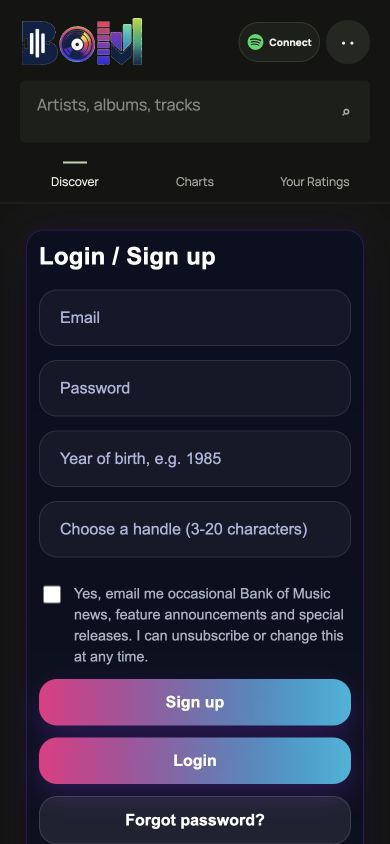
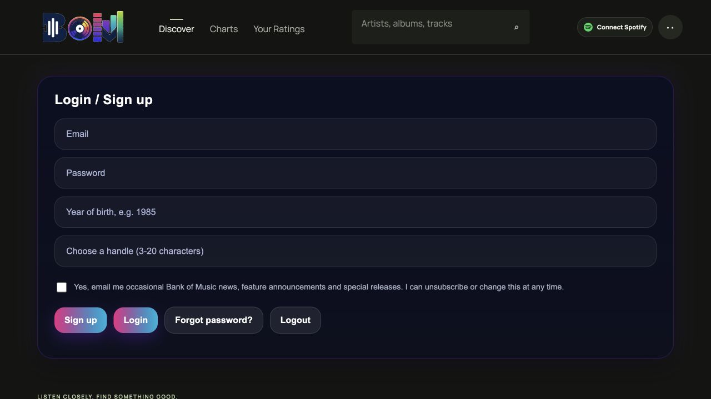

# Phase 1A review evidence

These screenshots compare the `e20e068` baseline with the Phase 1A branch. Both signed-out captures use the same local, read-only catalogue fixture.

## iPhone · 390×844

| Before | After |
| --- | --- |
|  |  |

## Desktop · 1280×720

| Before | After |
| --- | --- |
|  |  |

## Validation

- Frontend regression suite: **802/802 passed**.
- Database and Edge Function suite on the supported Node 24 runtime: **373/373 passed**.
- Focused authentication and Quick Rate regression set: **136/136 passed**.
- Focused guest database projection test: **1/1 passed**.
- Supabase TypeScript check: passed.
- Visual regression check: passed at 360, 375, 390 and 1200 px with no horizontal overflow, including the saved-versus-pending review controls.
- Manual signed-out journey: Quick Rate is first, browsing remains public, and rating submission opens the existing sign-in form with context retained.
- Returning-member regressions: an existing rating is shown alongside the pending selection; `Unrated` switches to `All` for the exact hidden target; confirm, amend, and keep paths require explicit action and coalesce duplicate restoration events.
- Fixture-member journey: existing Quick Rate progress and direct rating behaviour remain intact.
- Source/public parity: all publication assets have identical source/public hashes.
- Performance check: guest first paint still does not fetch historical carousel data or trigger a duplicate full-catalogue refresh. The release-blocker fix adds 1,512 gzip bytes to the reviewed PR head (`app.js` +1,280; `bom-foundation.css` +232) and no new eager request or dependency.
- Disposable database security check: all five backing tables had RLS enabled; guest projection contained no user ID or personal rating/progress; anonymous insert was rejected, update/delete affected zero rows, authenticated output was identical before/after, function and policy metadata were unchanged, and the documented rollback/re-apply succeeded.

No deployment, migration application, live rating write, merge, or production data change was performed.

The production release and rollback procedure is documented in [release-sequence.md](release-sequence.md). It includes the recorded Cloudflare rollback deployment, database permission verification, protected-main squash merge, exact-commit manual deployment, private-browser smoke tests, and the permission-only database rollback.
