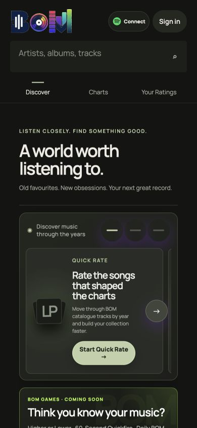
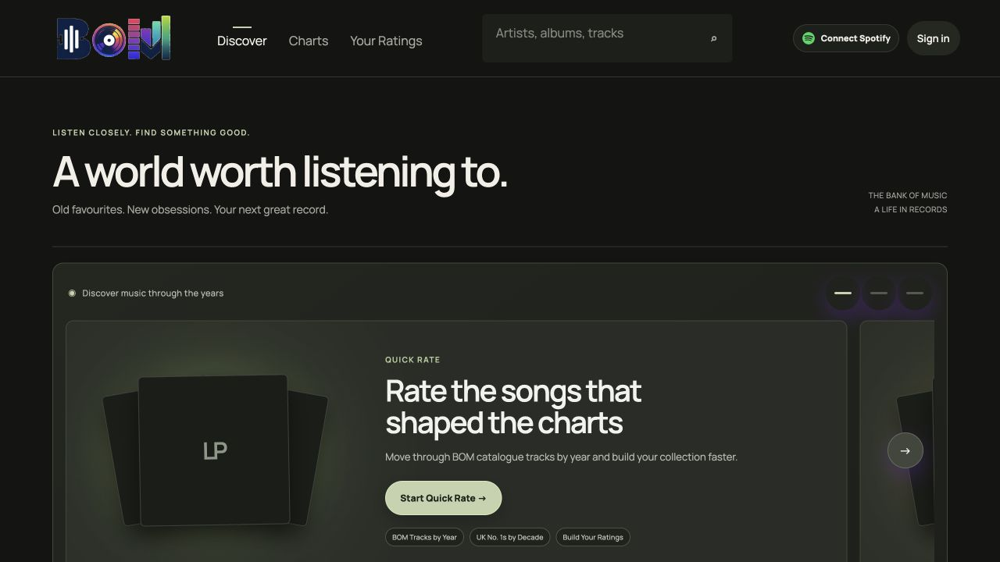

# Phase 1A review evidence

These screenshots compare the `e20e068` baseline with the Phase 1A branch. Both signed-out captures use the same local, read-only catalogue fixture.

## iPhone · 390×844

| Before | After |
| --- | --- |
|  |  |

## Desktop · 1280×720

| Before | After |
| --- | --- |
|  |  |

## Validation

- Frontend regression suite: **797/797 passed**.
- Database and Edge Function suite on the supported Node 24 runtime: **373/373 passed**.
- Focused Phase 1A regression set: **96/96 passed**.
- Focused guest database projection test: **1/1 passed**.
- Supabase TypeScript check: passed.
- Visual regression check: passed at 360, 375, 390 and 1200 px with no horizontal overflow.
- Manual signed-out journey: Quick Rate is first, browsing remains public, and rating submission opens the existing sign-in form with context retained.
- Fixture-member journey: existing Quick Rate progress and direct rating behaviour remain intact.
- Source/public parity: all five changed publication assets have identical hashes.
- Performance check: guest first paint does not fetch historical carousel data or trigger a duplicate full-catalogue refresh; guest carousel hydration begins only after manual navigation.

No deployment, migration application, live rating write, merge, or production data change was performed.
